## 📌 About Me

I am a final-year B.Tech Computer Science and Engineering student at **Amrita Vishwa Vidyapeetham** (Class of 2027), focusing on **Artificial Intelligence, Machine Learning, Computer Vision, and Full-Stack Development**. My work centers on bridging rigorous research with practical engineering, with core experience in **distributed systems, federated learning, and edge-fog-cloud architectures**. With hands-on experience developing both scalable software platforms and firmware for **embedded systems**, I build reliable, production-ready solutions designed for performance and real-world impact.

---

## 🛠️ Technical Skills

### **Programming Languages**

### **AI & Machine Learning**

### **Frameworks & Backend**

### **Databases**

### **DevOps & Tools**

### **Embedded Systems**

---

## 📊 GitHub Statistics

---

## 📈 Contribution Activity

---

## 📬 Connect With Me

---

  Designed with focus on clarity, performance, and engineering precision.

